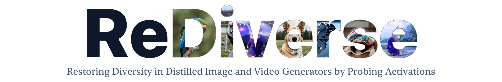
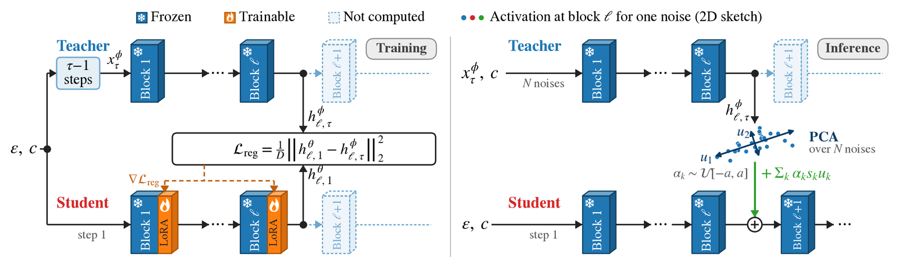
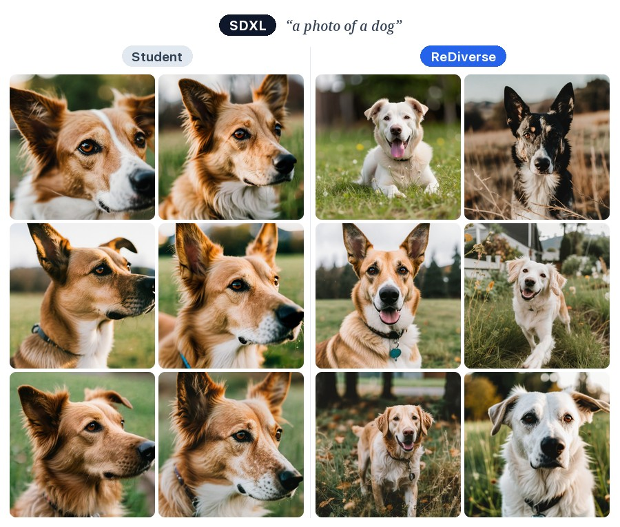
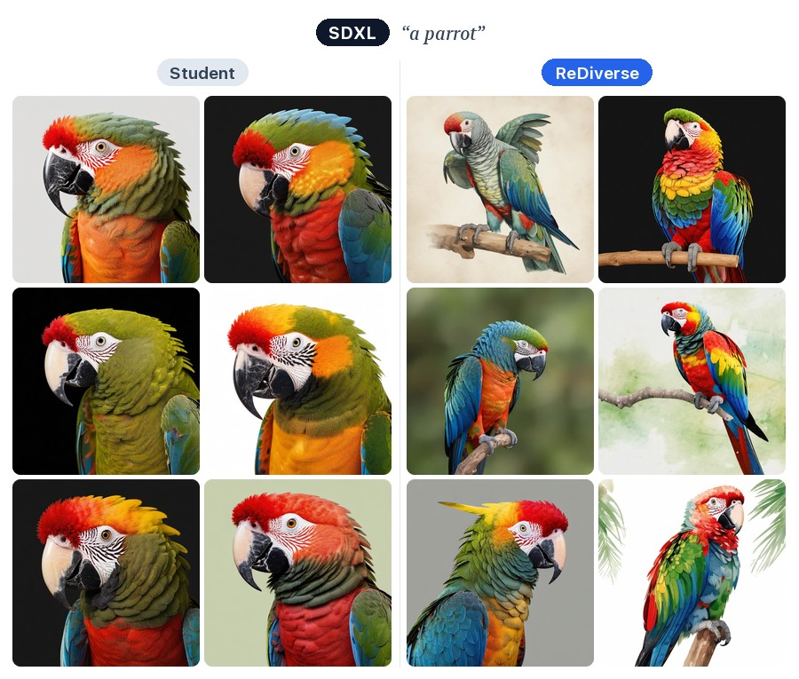
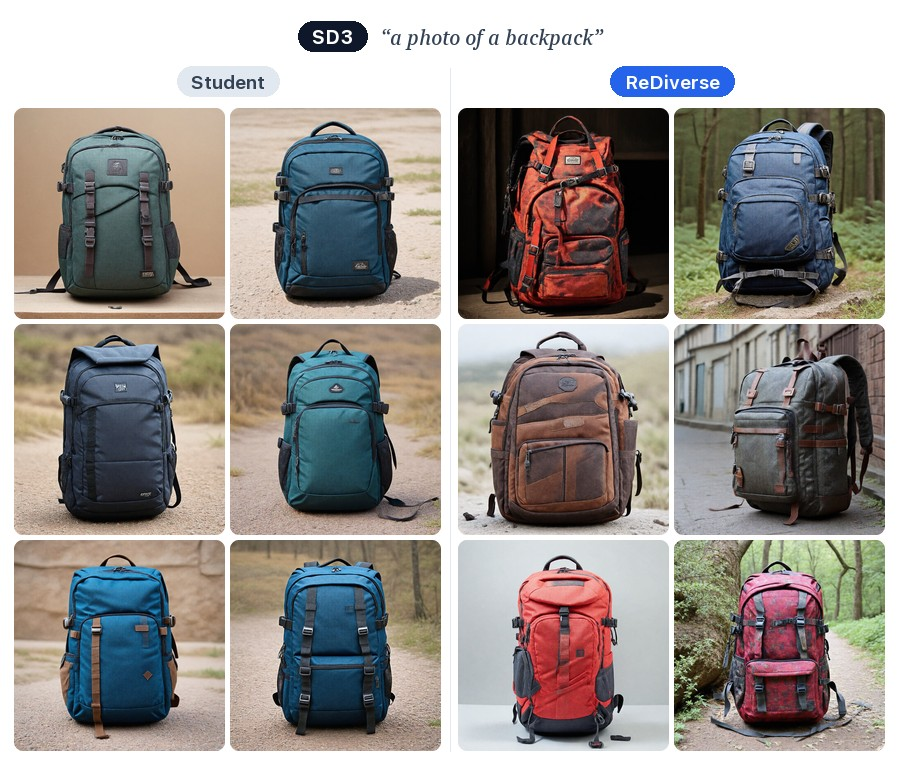
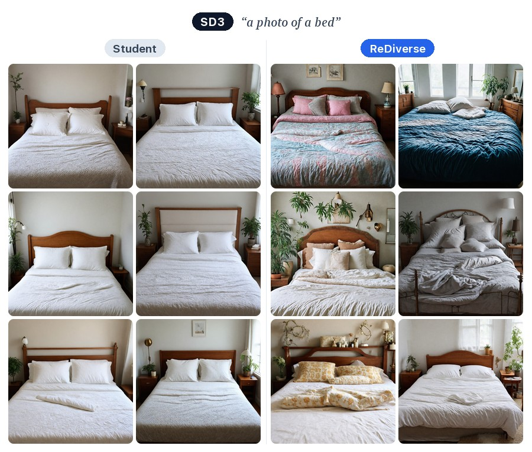
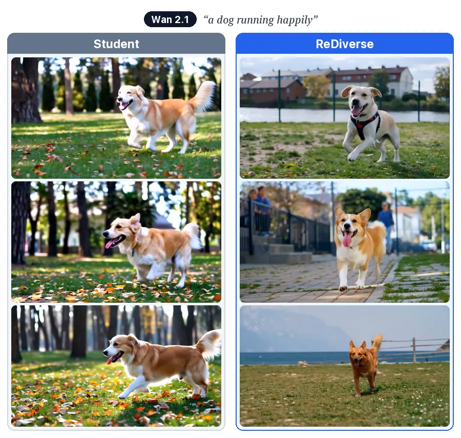
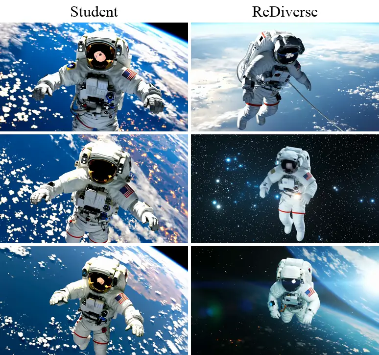
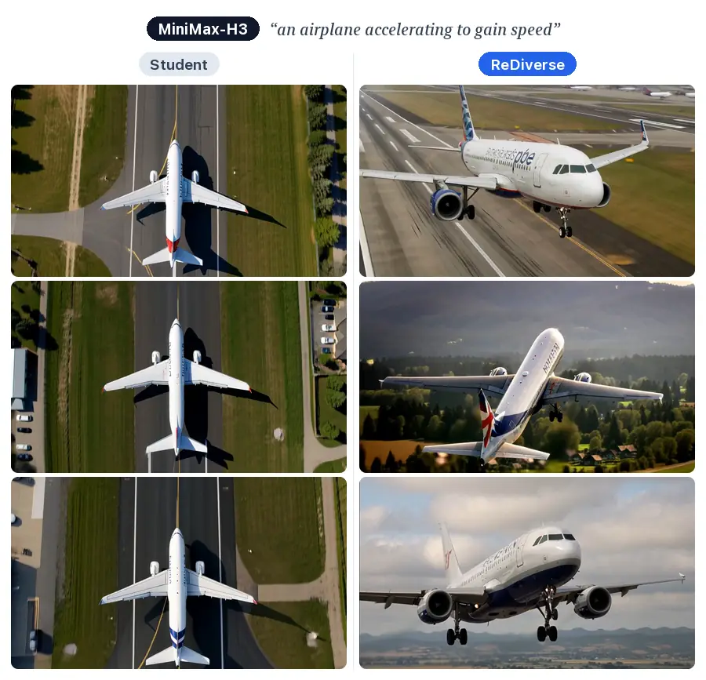
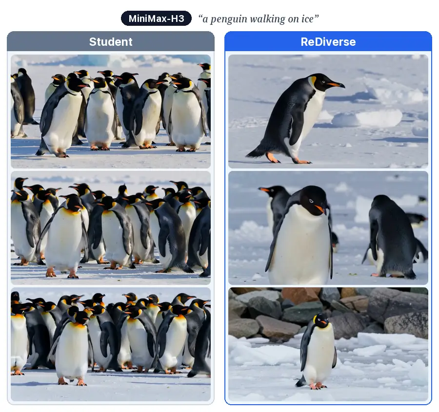

<p align="center">
  <picture>
    <source media="(prefers-color-scheme: dark)" srcset="assets/banner_dark.png">
    
  </picture>
</p>

<p align="center">
  Furkan Horoz<sup>1</sup>,
  Ozgur Kara<sup>1</sup>,
  Kaan Oktay<sup>2</sup>,
  Adil Kaan Akan<sup>2</sup>,
  Atakan Kara<sup>2</sup>,
  Anand Bhattad<sup>3,†</sup>,
  James Matthew Rehg<sup>1,†</sup>
</p>

<p align="center">
  <sup>1</sup>University of Illinois at Urbana-Champaign &nbsp;&nbsp; <sup>2</sup>fal &nbsp;&nbsp; <sup>3</sup>Johns Hopkins University<br>
  <b>Preprint, 2026</b><br>
  <sub><sup>†</sup>Equal advising.</sub>
</p>

<p align="center">
  <a href="https://rediverse-distillation.github.io/rediverse-distillation/"></a>
  
  <a href="https://huggingface.co/ReDiverse/ReDiverse"></a>
  <a href="LICENSE"></a>
</p>

**TL;DR.** Few-step distilled students lose sample diversity. Probing their activations shows why: the student keeps
the teacher's activation variance across seeds but squeezes it into far fewer directions, starting at one block in the
first denoising step. ReDiverse puts the missing directions back at that block, either with a short LoRA fine-tune
(**ReDiverse-FT**) or with no training at all (**ReDiverse-TF**), on SDXL, SD3, Wan 2.1 and MiniMax-H3.

<details>
<summary>Click for the full abstract</summary>

Distilling diffusion models into few-step student models substantially reduces sampling latency, but induces severe
diversity collapse: samples generated from different random seeds show minimal variation. In this work, we investigate
the root cause of this failure by probing the internal representations of student models relative to their teachers.
We find that distilled students maintain total activation variance comparable to their teachers, but concentrate it
into substantially fewer directions. This directional collapse is localized to an identifiable intermediate block at the
initial denoising step. Consequently, diversity collapse stems from a misallocation of activation variance rather than
an inherent loss of generative capacity. Guided by this finding, we propose ReDiverse to reinstate the missing variance
directions. At training time, ReDiverse-FT fine-tunes a lightweight adapter that regresses student activations onto the
teacher's, reviving the teacher's feature variance characteristic. At inference time, ReDiverse-TF introduces a
training-free mechanism that steers activations along precomputed teacher principal directions. Across image and video
distillation benchmarks, ReDiverse consistently restores sample diversity while preserving generation quality, further
supported by the user study.
</details>

## 📰 Updates

- **[11/2026]** Code, the activation probe and the ReDiverse-FT adapters for SDXL, SD3, Wan 2.1 and MiniMax-H3 on
  🤗 [Hugging Face](https://huggingface.co/ReDiverse/ReDiverse).

## 🔍 Method

<p align="center"></p>

- **Probe.** Feed the same noises to teacher and student and measure, at every block of the first step, the total
  variance of the activations and their participation ratio (how many directions that variance spans). The block where
  the student's participation ratio drops is the collapsed block ℓ.
- **ReDiverse-FT.** A rank-32 LoRA on the blocks up to ℓ regresses the student's step-1 activation at ℓ onto the
  teacher's activation at step τ, from the same noise and prompt. It is active in the first step only.
- **ReDiverse-TF.** For each prompt, PCA over 25 teacher runs gives directions u<sub>k</sub> and spreads s<sub>k</sub>;
  every sample adds Σ<sub>k</sub> α<sub>k</sub> s<sub>k</sub> u<sub>k</sub> (K = 8, α<sub>k</sub> ~ U[−2, 2]) to the
  student's activation at ℓ in step 1. No weights change.

| Backbone | Teacher | 4-step student | Collapsed block ℓ | τ |
|---|---|---|---|---:|
| SDXL | SDXL-base 1.0 | DMD2 | `up_blocks.0.attentions.0` | 7 |
| SD3 | SD3-Medium | TDM | `transformer_blocks.12` | 9 |
| Wan 2.1 | Wan2.1-T2V-14B | lightx2v | `blocks.28` | 8 |
| MiniMax-H3 | MiniMax-H3 | Turbo | `transformer_blocks.45` | 16 |

## 📈 Results

Sample diversity (DINO, mean pairwise distance between the samples of a prompt, ×100, higher is more diverse) on
GenEval (553 prompts × 100 seeds) and VBench (300 prompts × 10 clips). Every row except the teacher samples in four
steps. The full diversity and quality tables are in the paper; [`docs/REPRODUCE.md`](docs/REPRODUCE.md) has the
commands that regenerate them.

| DINO diversity ↑ | SDXL | SD3 | Wan 2.1 | MiniMax-H3 |
|---|---:|---:|---:|---:|
| Student | 59.4 | 48.4 | 31.6 | 36.5 |
| ReDiverse-TF | 60.1 | 53.8 | 34.6 | 42.2 |
| ReDiverse-FT | 64.6 | 53.5 | 46.8 | 44.1 |
| **ReDiverse** | **65.0** | **60.1** | **52.2** | **50.9** |
| *Teacher (multi-step)* | *66.3* | *61.6* | *51.6* | *52.5* |

<p align="center">
  
  
</p>
<p align="center">
  
  
</p>
<p align="center">
  
  
</p>
<p align="center">
  
  
</p>
<p align="center"><em>In each figure, every ReDiverse sample starts from the same noise as the student sample at the same position. The
student repeats one shot (the same close-up, the same park, the same top-down runway); ReDiverse varies the subject, the
style, the setting and the camera. More examples are on the
<a href="https://rediverse-distillation.github.io/rediverse-distillation/">project page</a>.</em></p>

## 📦 Model zoo

The ReDiverse-FT adapters are on 🤗 [Hugging Face: ReDiverse/ReDiverse](https://huggingface.co/ReDiverse/ReDiverse); the
generators below download them on first use. ReDiverse-TF needs no weights.

| Backbone | 4-step student | Adapter | Size | License |
|---|---|---|---:|---|
| SDXL | [DMD2](https://huggingface.co/tianweiy/DMD2) | 🤗 [`sdxl/rediverse_ft.safetensors`](https://huggingface.co/ReDiverse/ReDiverse/tree/main/sdxl) | 216 MB | CC BY-NC-SA 4.0 + Open RAIL++-M restrictions |
| SD3 | [TDM](https://huggingface.co/Luo-Yihong/TDM_sd3_lora) | 🤗 [`sd3/rediverse_ft.safetensors`](https://huggingface.co/ReDiverse/ReDiverse/tree/main/sd3) | 89 MB | Stability AI Community License |
| Wan 2.1 | [lightx2v](https://huggingface.co/lightx2v/Wan2.1-T2V-14B-StepDistill-CfgDistill-Lightx2v) | 🤗 [`wan2.1/rediverse_ft.safetensors`](https://huggingface.co/ReDiverse/ReDiverse/tree/main/wan2.1) | 445 MB | Apache-2.0 |
| MiniMax-H3 | [Turbo](https://huggingface.co/lightx2v/Minimax-h3-Turbo) | 🤗 [`minimax-h3/rediverse_ft.safetensors`](https://huggingface.co/ReDiverse/ReDiverse/tree/main/minimax-h3) | 612 MB | MiniMax H3 Community License |

The MiniMax-H3 adapter is released for research purposes. Its use is governed by the MiniMax H3 Community License,
whose Applicable Territory excludes the EU, the UK, the Republic of Korea and the USA; check that the license allows
your use before downloading or running MiniMax-H3 or the adapter.

## ⚙️ Setup

```bash
git clone https://github.com/H-furkan/rediverse && cd rediverse
python3.12 -m venv venvs/image && venvs/image/bin/pip install --no-deps -r envs/requirements-image.txt   # SDXL
python3.12 -m venv venvs/train && venvs/train/bin/pip install --no-deps -r envs/requirements-train.txt   # SD3, training
python3.12 -m venv venvs/video && venvs/video/bin/pip install --no-deps -r envs/requirements-video.txt   # Wan 2.1, MiniMax-H3, probing
```

The backbones need different `diffusers` / `transformers` pins, so each runs in its own environment;
[`envs/README.md`](envs/README.md) maps every stage to its environment. All experiments used 80 GB H100s. SD3-Medium is
gated on the Hub: accept its license and run `hf auth login` first.

## 🚀 Quick start

`--arm` is one of `teacher`, `student`, `rediverse_ft`, `rediverse_tf` or `rediverse` (both parts); samples go to
`outputs/<backbone>/prompt/<prompt>/<arm>/`.

```bash
python -m sdxl.generate --arm rediverse --prompt "a photo of a fox in the snow" --num-samples 4    # image env
python -m sd3.generate  --arm rediverse --prompt "a photo of a fox in the snow" --num-samples 4    # train env
python -m wan.generate  --arm rediverse --prompt "a corgi surfing a wave at sunset" --num-samples 4  # video env
python -m h3.generate   --arm rediverse --prompt "a corgi running on the beach at sunset" --num-samples 4  # video env
```

Before downloading or running MiniMax-H3, check that the territory and terms of the MiniMax H3 Community License allow
your use.

The TF arms first estimate the prompt's teacher directions (about 15 s on SDXL and SD3, 15 min on Wan 2.1, one
GPU-hour on MiniMax-H3) and cache them next to the samples. Each backbone README ([`sdxl/`](sdxl/README.md),
[`sd3/`](sd3/README.md), [`wan/`](wan/README.md), [`h3/`](h3/README.md)) documents its main options;
`python -m <backbone>.generate --help` lists all of them.

## 🔬 Probing

Measure the total variance and participation ratio of every block, teacher against student, and print the ratios at
the collapsed block (paper Tab. 1):

```bash
python -m sdxl.probe --arm teacher --prompt-ids 27     # video env, ~4 min per arm on an H100
python -m sdxl.probe --arm student --prompt-ids 27
python -m rediverse.probe_report --backbone sdxl --plot sdxl_probe.png
```

The SDXL probe stages about 184 GB of activations in host RAM; on a smaller host add e.g. `--ram-gb 64` (more passes
over the same noises, same values). `sd3.probe`, `wan.probe` and `h3.probe` work the same way; report them with
`rediverse.probe_report --backbone sd3 | wan2.1 | minimax-h3`. All four probes, including the image ones, run in the
`video` environment. Over the paper's 100 prompts the SDXL probe reproduces Tab. 1 to its two decimals (participation ratio 0.40,
total variance 1.63, concentration 4.76).

## 🏋️ Training and 📊 evaluation

Each backbone has an end-to-end driver that prepares data, trains the ReDiverse-FT adapter, estimates the ReDiverse-TF
directions and generates the benchmark samples:

```bash
export HF_HOME=${HF_HOME:-$HOME/.cache/huggingface}
PY_IMAGE=venvs/image/bin/python PY_TRAIN=venvs/train/bin/python ADAPTER=outputs/sdxl/release \
  bash scripts/sdxl.sh data train directions generate
PY_TRAIN=venvs/train/bin/python ADAPTER=outputs/sd3/release bash scripts/sd3.sh data train directions generate
PY_TRAIN=venvs/train/bin/python PY_VIDEO=venvs/video/bin/python ADAPTER=outputs/wan2.1/release \
  bash scripts/wan.sh encode bank train directions generate
PY_VIDEO=venvs/video/bin/python ADAPTER=outputs/minimax-h3/train/rediverse_ft \
  bash scripts/h3.sh encode bank train directions generate
```

Without `ADAPTER`, `generate` uses the released adapter from the Hub. [`scripts/README.md`](scripts/README.md) lists the
stages and variables of every driver. The image and video metrics and the table scripts are in
[`evaluation/`](evaluation/README.md). The commands behind the main
comparison, the design-choice and ablation tables and the probe results, with GPU times, are in
[`docs/REPRODUCE.md`](docs/REPRODUCE.md). Not included: the baselines (Noise Optimization, DP-DMD, DFD), the user study
and the VLM-as-a-judge study, the comparison of two MiniMax-H3 students (Tab. 6, FastVideo and Turbo), the paired
comparison with the student (win rates and sign test) and the SAM 3 foreground and background diversity.

## 📄 License

The code is released under the [Apache License 2.0](LICENSE). The adapters follow the licenses of their base models:
SDXL CC BY-NC-SA 4.0 with the Open RAIL++-M use restrictions, SD3 the Stability AI Community License, Wan 2.1 Apache-2.0;
MiniMax-H3 is distributed under the MiniMax H3 Community License. Details are in [`docs/REPRODUCE.md`](docs/REPRODUCE.md#license).

## 🙏 Acknowledgements

We thank [fal](https://fal.ai) for the compute grants that supported this research. The authors acknowledge the support
of the Health Care Engineering Systems Center within the Coordinated Science Lab at UIUC.

This work builds on [diffusers](https://github.com/huggingface/diffusers), [NVIDIA FastGen](https://github.com/NVlabs/FastGen)
and the public teachers and students it studies: [SDXL](https://huggingface.co/stabilityai/stable-diffusion-xl-base-1.0)
with [DMD2](https://github.com/tianweiy/DMD2), [SD3-Medium](https://huggingface.co/stabilityai/stable-diffusion-3-medium)
with [TDM](https://github.com/Luo-Yihong/TDM), [Wan 2.1](https://github.com/Wan-Video/Wan2.1) with
[lightx2v](https://github.com/ModelTC/LightX2V), and [MiniMax-H3](https://huggingface.co/MiniMaxAI/MiniMax-H3) with
[Turbo](https://huggingface.co/lightx2v/Minimax-h3-Turbo). The Wan 2.1 training targets use the
[Perflow CFG5-to-CFG1 LoRA](https://huggingface.co/Perflow-Shuai/Wan2.1-T2V-14B-CFG5-to-CFG1-50Step-LoRA-r128-iter500)
as the CFG-distilled teacher. Prompts come from [GenEval](https://github.com/djghosh13/geneval) and
[VBench](https://github.com/Vchitect/VBench); the training captions from [DiffusionDB](https://github.com/poloclub/diffusiondb).

## 📚 Citation

```bibtex
@misc{horoz2026rediverse,
  title  = {Restoring Diversity in Distilled Image and Video Generators by Probing Activations},
  author = {Horoz, Furkan and Kara, Ozgur and Oktay, Kaan and Akan, Adil Kaan and Kara, Atakan and Bhattad, Anand and Rehg, James Matthew},
  year   = {2026},
  url    = {https://rediverse-distillation.github.io/rediverse-distillation/}
}
```
