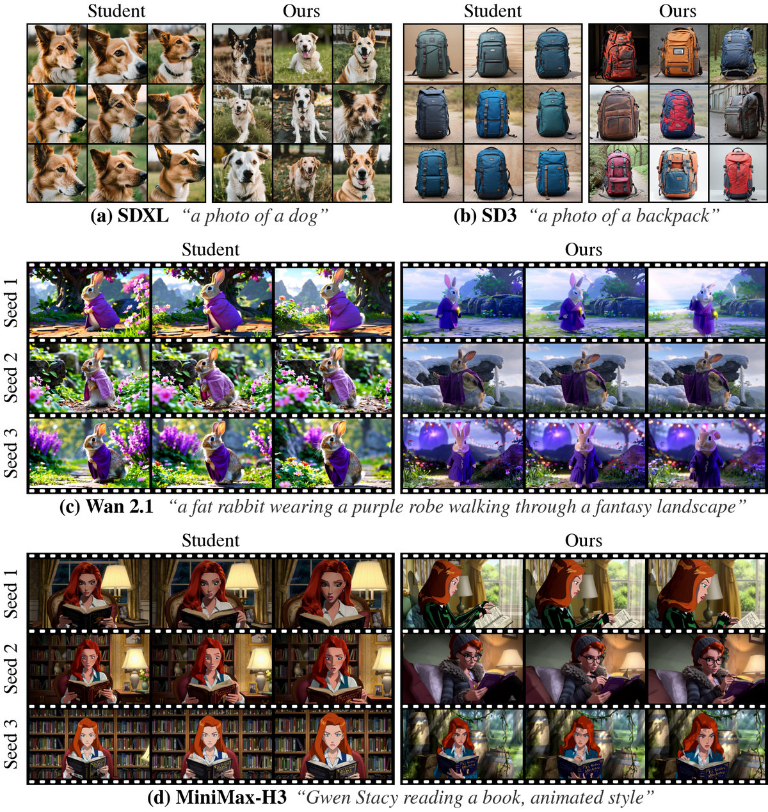
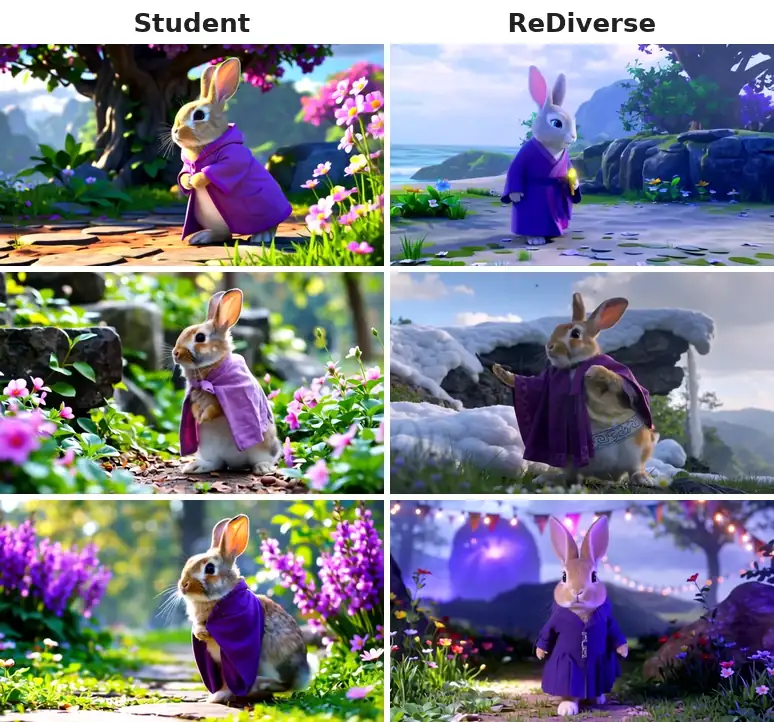
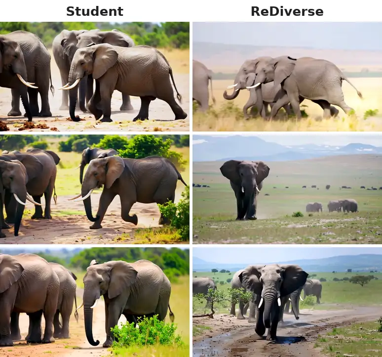
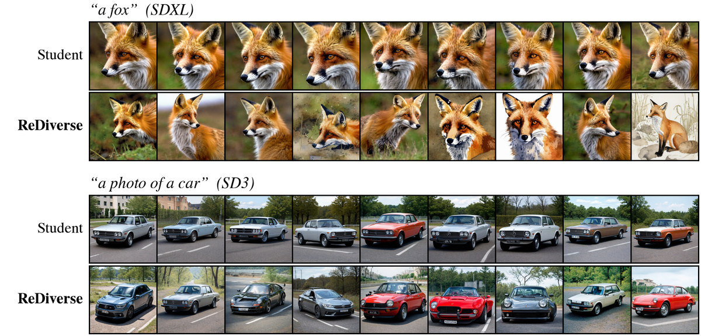

<h1 align="center">Restoring Diversity in Distilled Image and Video Generators by Probing Activations</h1>

<p align="center">
  Furkan Horoz<sup>1*</sup>&nbsp;&nbsp;
  Ozgur Kara<sup>1*</sup>&nbsp;&nbsp;
  Kaan Oktay<sup>2</sup>&nbsp;&nbsp;
  Adil Kaan Akan<sup>2</sup>&nbsp;&nbsp;
  Atakan Kara<sup>2</sup>&nbsp;&nbsp;
  Anand Bhattad<sup>3&dagger;</sup>&nbsp;&nbsp;
  James Matthew Rehg<sup>1&dagger;</sup>
</p>
<p align="center">
  <sup>1</sup>University of Illinois at Urbana-Champaign&nbsp;&nbsp;
  <sup>2</sup>fal&nbsp;&nbsp;
  <sup>3</sup>Johns Hopkins University
  <br>
  <sup>*</sup>Equal contribution&nbsp;&nbsp;&nbsp;<sup>&dagger;</sup>Equal advising
</p>

<p align="center">
  <a href="https://huggingface.co/Fo-zh/ReDiverse"></a>
  <a href="LICENSE"></a>
</p>

<p align="center">
  
</p>
<p align="center"><sub>For a fixed prompt, the 4-step student repeats similar compositions, while ReDiverse
(<i>Ours</i>) produces broader variation. Each image grid shows samples from different seeds; each video row is one
seed, with time running from left to right.</sub></p>

<table>
  <tr>
    <td align="center" width="50%"></td>
    <td align="center" width="50%"></td>
  </tr>
  <tr>
    <td align="center"><sub>Wan 2.1: <i>"A fat rabbit wearing a purple robe walking through a fantasy landscape."</i></sub></td>
    <td align="center"><sub>Wan 2.1: <i>"an elephant running to join a herd of its kind"</i></sub></td>
  </tr>
</table>
<p align="center"><sub>Seed-matched clips: each row starts from the same noise in both columns.</sub></p>

## Contents

- [Overview](#overview)
- [Method](#method)
- [Results](#results)
- [Installation](#installation)
- [Quickstart](#quickstart)
- [Released weights](#released-weights)
- [Reproducing the paper](#reproducing-the-paper)
- [Repository structure](#repository-structure)
- [Citation](#citation)
- [License](#license)
- [Acknowledgements](#acknowledgements)

## Overview

Distilling diffusion models into few-step students substantially reduces sampling latency, but
induces severe diversity collapse: samples generated from different random seeds show minimal
variation. Probing the internal representations of students relative to their teachers, we find
that distilled students maintain total activation variance comparable to their teachers but
concentrate it into substantially fewer directions, and that this directional collapse is localized
to an identifiable intermediate block at the initial denoising step. **ReDiverse** reinstates the
missing variance directions at that block: **ReDiverse-FT** fine-tunes a lightweight adapter that
regresses student activations onto the teacher's, and **ReDiverse-TF** is a training-free mechanism
that steers activations along precomputed teacher principal directions. Across image (SDXL, SD3) and
video (Wan 2.1, MiniMax-H3) distillation benchmarks, ReDiverse consistently restores sample diversity
while preserving generation quality.

## Method

<p align="center">
  
</p>

Both parts act only at the collapsed block ℓ in the student's **first** denoising step; the later
blocks and steps run unchanged and render with the student's own fidelity.

- **ReDiverse-FT** (left). The student and the frozen teacher start from the same noise ε and prompt
  c. The student's activation at block ℓ in step 1 is regressed onto the teacher's activation at the
  same block at step τ, reached after τ−1 teacher steps from the same noise:

  ```math
  \mathcal{L}_{\mathrm{reg}} = \frac{1}{D}\,\bigl\lVert h^{\theta}_{\ell,1}(\epsilon, c) - h^{\phi}_{\ell,\tau}(x^{\phi}_{\tau}, c)\bigr\rVert_2^2
  ```

  Each prompt is paired with several noises, so matching activations noise by noise restores the
  teacher's variation across seeds. The trainable part is a LoRA (rank 32, alpha 32) on the attention
  and feed-forward projections of the blocks up to and including ℓ, enabled in the first sampling
  step only.
- **ReDiverse-TF** (right). For each prompt, the teacher is run from N = 25 noises to step τ, and PCA
  of its centred block-ℓ activations gives principal directions u<sub>k</sub> and spreads
  s<sub>k</sub>. Every sample adds Σ<sub>k</sub> α<sub>k</sub> s<sub>k</sub> u<sub>k</sub> over the
  top K = 8 directions, with α<sub>k</sub> ~ U[−2, 2] drawn per sample, to the student's block-ℓ
  activation in step 1. No weights change.
- **ReDiverse** applies the ReDiverse-TF directions on top of the ReDiverse-FT adapter.

| Backbone | Teacher | 4-step student | Collapsed block ℓ | ReDiverse-FT target | ReDiverse-TF directions |
|---|---|---|---|---|---|
| SDXL | SDXL-base 1.0, 50 Euler steps, CFG 8 | DMD2 | `up_blocks.0.attentions.0` | conditional forward 7, after 6 teacher steps at CFG 8 | conditional teacher, forward 7 |
| SD3 | SD3-Medium, 28 steps, CFG 7 | TDM LoRA | `transformer_blocks.12` (image stream) | conditional forward 9, after 8 teacher steps at CFG 7 | conditional teacher, forward 9 |
| Wan 2.1 | Wan2.1-T2V-14B, 50 UniPC steps, CFG 5 | lightx2v StepDistill-CfgDistill | `blocks.28` | forward 13 of the CFG-distilled teacher (Perflow CFG5-to-CFG1 LoRA, guidance 1, flow shift 5) | conditional teacher, forward 8 |
| MiniMax-H3 | MiniMax-H3, 50 steps, guidance-distilled | lightx2v Turbo LoRA | `transformer_blocks.45` (video tokens) | teacher forward 16 | teacher forward 16 |

## Results

Main comparison of the paper. All metrics are higher-is-better and are reported x100 with
one decimal, except Vendi and IR. The teacher is the multi-step reference.

**Distilled image models.** GenEval prompts (553) x 100 seeds, 1024x1024. Diversity: DINO,
DS (DreamSim), LP (LPIPS), TP (TPIPS averaged over its five aspects), Vendi. Quality: CS (CLIPScore),
HPS (HPSv2.1), IR (ImageReward). TP averages TPIPS overall (all 553 prompts) with its four aspects
(a 100-prompt subset).

| Backbone | Method | DINO | DS | LP | TP | Vendi | CS | HPS | IR |
|---|---|---:|---:|---:|---:|---:|---:|---:|---:|
| **SDXL** | Student | 59.4 | 27.6 | 65.2 | 19.0 | 5.02 | 33.0 | 30.4 | 0.854 |
| | ReDiverse-TF | 60.1 | 28.4 | 65.6 | 19.6 | 5.30 | 33.0 | 30.3 | 0.836 |
| | ReDiverse-FT | 64.6 | 32.9 | 67.8 | 22.6 | 6.74 | 32.8 | 29.8 | 0.694 |
| | **ReDiverse** | **65.0** | **33.3** | **67.9** | **23.0** | **7.03** | 32.7 | 29.7 | 0.672 |
| | *Teacher* | *66.3* | *36.0* | *65.9* | *24.1* | *7.66* | *32.9* | *29.2* | *0.695* |
| **SD3** | Student | 48.4 | 19.2 | 55.1 | 13.8 | 3.78 | 33.3 | 30.1 | 1.026 |
| | ReDiverse-TF | 53.8 | 23.5 | 60.7 | 17.0 | 4.86 | 33.1 | 29.7 | 0.965 |
| | ReDiverse-FT | 53.5 | 22.7 | 58.0 | 15.3 | 4.66 | 33.5 | 29.2 | 0.992 |
| | **ReDiverse** | **60.1** | **28.3** | **64.9** | **20.3** | **6.24** | 32.9 | 29.0 | 0.872 |
| | *Teacher* | *61.6* | *30.3* | *67.0* | *21.1* | *6.02* | *33.4* | *29.5* | *1.017* |

**Distilled video models.** VBench prompts (300) x 10 clips (Wan 2.1: 81 frames at 832x480;
MiniMax-H3: 124 frames at 1344x768). Diversity: DINO, VJ (V-JEPA 2), TP (TPIPS), Cam
(camera-trajectory diversity), VC (ViCLIP diversity). Quality: SC, BC (VBench subject and background
consistency), VCS (ViCLIP text-video similarity). TP: overall on all 300 prompts, aspects on a
100-prompt subset; Cam on 30 prompts; SC and BC on the VBench prompts assigned to those dimensions
(23 and 27).

| Backbone | Method | DINO | VJ | TP | Cam | VC | SC | BC | VCS |
|---|---|---:|---:|---:|---:|---:|---:|---:|---:|
| **Wan 2.1** | Student | 31.6 | 11.2 | 23.2 | 36.2 | 22.6 | 96.7 | 95.6 | 21.5 |
| | ReDiverse-TF | 34.6 | 12.5 | 26.3 | 35.8 | 26.1 | 96.3 | 95.2 | 21.5 |
| | ReDiverse-FT | 46.8 | 17.0 | 28.7 | **40.6** | 34.7 | 96.4 | 96.4 | 20.8 |
| | **ReDiverse** | **52.2** | **18.7** | **32.6** | 40.0 | **40.0** | 95.0 | 95.9 | 20.5 |
| | *Teacher* | *51.6* | *20.9* | *31.3* | *36.2* | *36.2* | *94.7* | *97.3* | *21.4* |
| **MiniMax-H3** | Student | 36.5 | 12.4 | 23.0 | 26.9 | 28.4 | 94.0 | 95.1 | 19.9 |
| | ReDiverse-TF | 42.2 | 13.4 | 26.4 | 29.4 | 33.6 | 93.4 | 94.1 | 19.8 |
| | ReDiverse-FT | 44.1 | 15.9 | 26.2 | 33.2 | 32.2 | 94.8 | 95.5 | 20.1 |
| | **ReDiverse** | **50.9** | **16.2** | **29.9** | **35.6** | **38.6** | 94.2 | 94.0 | 19.8 |
| | *Teacher* | *52.5* | *20.7* | *30.4* | *37.7* | *37.2* | *92.8* | *94.6* | *20.7* |

Bold marks the best diversity value among the 4-step rows.

<p align="center">
  
</p>
<p align="center"><sub>Seed-matched samples of the 4-step students and ReDiverse on SDXL (<i>"a fox"</i>) and SD3
(<i>"a photo of a car"</i>).</sub></p>

## Installation

```bash
git clone https://github.com/H-furkan/ReDiverse-code
cd ReDiverse-code
```

The paper's numbers come from six Python environments whose pins are incompatible (for example,
MiniMax-H3 needs diffusers 0.40 / transformers 5.x, while ImageReward needs transformers < 4.57).
[`envs/`](envs/README.md) pins every package of each one; install them with `--no-deps`:

```bash
python3.12 -m venv venvs/train  && venvs/train/bin/pip  install --no-deps -r envs/requirements-train.txt
python3.12 -m venv venvs/image  && venvs/image/bin/pip  install --no-deps -r envs/requirements-image.txt
python3.12 -m venv venvs/video  && venvs/video/bin/pip  install --no-deps -r envs/requirements-video.txt
python3.12 -m venv venvs/tpips  && venvs/tpips/bin/pip  install --no-deps -r envs/requirements-tpips.txt
python3.10 -m venv venvs/vbench && venvs/vbench/bin/pip install --no-deps -r envs/requirements-vbench.txt
# vipe (camera trajectories only): see envs/vipe.md
```

| Environment | Used for |
|---|---|
| `train` | ReDiverse-FT training (SDXL, SD3, Wan 2.1); the Wan 2.1 target bank; everything for SD3 (caption encoding, noise bank, generation, directions) |
| `image` | SDXL noise bank, generation and directions; image metrics (DINO, Vendi, DreamSim, LPIPS, CLIPScore, HPSv2.1, ImageReward) and tables |
| `video` | Wan 2.1 text contexts, generation and directions; the whole MiniMax-H3 pipeline |
| `tpips` | TPIPS (images and video), video DINO and V-JEPA 2 features, video metric aggregation and tables |
| `vbench` | ViCLIP scores, VBench subject / background consistency |
| `vipe` | camera trajectories (ViPE) |

Requirements:

- NVIDIA GPUs with 80 GB of memory were used for every stage (H100); the `train` environment uses
  the CUDA 13.0 build of torch, the others CUDA 12.6.
- `ffmpeg` and `ffprobe` with `libx264` on `PATH`: every video is written through an ffmpeg pipe
  (H.264, CRF 17, yuv420p) and every video metric decodes frames with ffmpeg.
- Models are downloaded from the Hugging Face Hub into `HF_HOME` at pinned revisions on first use
  ([`evaluation/README.md`](evaluation/README.md) lists the few that the metric packages resolve
  themselves). SD3-Medium is gated: accept its license on the Hub and run `hf auth login` first.
- `REDIVERSE_DATA` (default `./data`) and `REDIVERSE_OUT` (default `./outputs`) relocate data and
  outputs. Run every command from the repository root.

## Quickstart

One prompt per backbone; the command has the same form on every backbone. `--arm` takes `teacher`,
`student`, `rediverse_ft`, `rediverse_tf` or `rediverse`, and `--num-samples` sets the number of
samples. They are written to `<REDIVERSE_OUT>/<backbone>/prompt/<slug>/<arm>/00.png`, `01.png`, ...
(`.mp4` for video), where `<slug>` is the prompt in lowercase with every run of other characters
replaced by `_` and leading/trailing `_` removed; a slug longer than 80 characters is cut to 71
characters and followed by `_` and an 8-character hash of the full prompt.

- On SDXL, SD3 and Wan 2.1 the FT arms (`rediverse_ft`, `rediverse`) download the released
  ReDiverse-FT adapter from the Hub on first use; `--adapter` points them at a local file or
  directory instead.
- The TF arms (`rediverse_tf`, `rediverse`) first estimate the prompt's teacher directions and save
  them to `<REDIVERSE_OUT>/<backbone>/prompt/<slug>/directions.pt`. Later calls reuse that file only
  when it holds the same prompt (on Wan 2.1 and MiniMax-H3 also the same `--prompt-index`) and
  estimate it again otherwise; `--directions FILE` uses another file as given. The teacher is freed
  before the student is loaded.
- Sample `k` follows the benchmark seed rules of prompt index 0. On Wan 2.1 and MiniMax-H3,
  `--prompt-index i` selects another index, so the text of VBench prompt `i` with `--prompt-index i`
  reproduces that prompt's benchmark clips.

**SDXL** (`image` environment):

```bash
python -m sdxl.generate --arm rediverse --prompt "a photo of a fox in the snow" --num-samples 4 --device cuda:0
# -> outputs/sdxl/prompt/a_photo_of_a_fox_in_the_snow/rediverse/00.png ... 03.png
```

**SD3** (`train` environment):

```bash
python -m sd3.generate --arm rediverse --prompt "a photo of a fox in the snow" --num-samples 4 --device cuda:0
# -> outputs/sd3/prompt/a_photo_of_a_fox_in_the_snow/rediverse/00.png ... 03.png
```

**Wan 2.1** (`video` environment). The first TF call for a prompt spends about 15 min on an H100
estimating its directions (a 2.7 GB file); `--arm rediverse_ft` needs none.

```bash
python -m wan.generate --arm rediverse --prompt "a corgi surfing a wave at sunset" --num-samples 4 --device cuda:0
# -> outputs/wan2.1/prompt/a_corgi_surfing_a_wave_at_sunset/rediverse/00.mp4 ... 03.mp4
```

**MiniMax-H3** (`video` environment), training-free ReDiverse-TF. The directions take about one
GPU-hour and 30 GB of host RAM on the first call for a prompt (a 3.2 GB file).

```bash
python -m h3.generate --arm rediverse_tf --prompt "a corgi running on the beach at sunset" --num-samples 4 --device cuda:0
# -> outputs/minimax-h3/prompt/a_corgi_running_on_the_beach_at_sunset/rediverse_tf/00.mp4 ... 03.mp4
```

The MiniMax-H3 ReDiverse-FT adapter is not on the Hub: its `rediverse_ft` and `rediverse` arms need
`--adapter` with an adapter trained by `h3.train` and converted by `h3.convert_weights` (see
[MiniMax-H3](#minimax-h3) below). Each backbone README lists the remaining options.

## Released weights

The ReDiverse-FT adapters are on the Hugging Face Hub at
[`Fo-zh/ReDiverse`](https://huggingface.co/Fo-zh/ReDiverse):

| Backbone | Student | Teacher | File | Size | License |
|---|---|---|---|---:|---|
| SDXL | [tianweiy/DMD2](https://huggingface.co/tianweiy/DMD2) (4-step UNet) | [stabilityai/stable-diffusion-xl-base-1.0](https://huggingface.co/stabilityai/stable-diffusion-xl-base-1.0) | `sdxl/rediverse_ft.safetensors` | 216 MB | CC BY-NC 4.0 (non-commercial), with the use restrictions of Open RAIL++-M |
| SD3 | [Luo-Yihong/TDM_sd3_lora](https://huggingface.co/Luo-Yihong/TDM_sd3_lora) | [stabilityai/stable-diffusion-3-medium-diffusers](https://huggingface.co/stabilityai/stable-diffusion-3-medium-diffusers) | `sd3/rediverse_ft.safetensors` | 89 MB | Stability AI Community License |
| Wan 2.1 | [lightx2v/Wan2.1-T2V-14B-StepDistill-CfgDistill-Lightx2v](https://huggingface.co/lightx2v/Wan2.1-T2V-14B-StepDistill-CfgDistill-Lightx2v) | [Wan-AI/Wan2.1-T2V-14B-Diffusers](https://huggingface.co/Wan-AI/Wan2.1-T2V-14B-Diffusers) | `wan2.1/rediverse_ft.safetensors` | 445 MB | Apache-2.0 |

Each file holds the fp32 LoRA tensors (rank 32, alpha 32) of one adapter under
`<module>.lora_A.weight` / `<module>.lora_B.weight`, with module paths inside the student's denoiser,
plus string metadata; the `config.json` beside it lists the adapted modules, the base models with
their pinned revisions and the recipe. The `sdxl/` and `sd3/` folders also hold the license texts of
their base models, and `sd3/` a `NOTICE` file (see [License](#license)). ReDiverse-TF needs no
weights: its directions are estimated per prompt by the code. The MiniMax-H3 adapter is not
distributed; [`h3/`](h3/README.md) trains and converts it locally.

## Reproducing the paper

Per backbone: data preparation, ReDiverse-FT training, ReDiverse-TF directions, generation of the
five arms (`teacher`, `student`, `rediverse_ft`, `rediverse_tf`, `rediverse`), evaluation, table.
Every default reproduces the released artifacts; the backbone READMEs give the exact recipes, seed
rules and file layouts. GPU times are for 80 GB H100s. Each backbone also has an end-to-end driver,
`bash scripts/<backbone>.sh <stage> ...` (see [`scripts/`](scripts/README.md)).

### SDXL

[`sdxl/README.md`](sdxl/README.md). ReDiverse-FT trains on [NVIDIA FastGen](https://github.com/NVlabs/FastGen)
(cloned at a pinned commit by `sdxl/setup_fastgen.sh`) on 100 DiffusionDB captions x 16 noises,
4 captions x 8 noises per step, 200 steps.

```bash
# data (image env): frozen evaluation noise, GenEval-553 x 100, 7.25 GB
python -m sdxl.make_noise_bank --device cuda:0
# ReDiverse-FT (train env): about 95 min on one GPU
bash sdxl/setup_fastgen.sh
python prompts/download_train_captions.py
python -m sdxl.encode_captions --device cuda:0
python -m sdxl.build_init_ckpt
export HF_HOME=${HF_HOME:-$HOME/.cache/huggingface}
CUDA_VISIBLE_DEVICES=0 python -m sdxl.train
python -m sdxl.convert_weights --src outputs/sdxl/train/adapters/rediverse_ft_0000200.pth --out-dir outputs/sdxl/release
# ReDiverse-TF directions (image env): about 14 s per prompt, 11.6 GB for all 553
python -m sdxl.estimate_directions --device cuda:0
# five arms (image env): about 9 GPU-hours per 4-step arm, 37 for the teacher
for arm in teacher student rediverse_ft rediverse_tf rediverse; do
  python -m sdxl.generate --arm $arm --device cuda:0
done
```

`sdxl.generate` uses the released adapter; `--adapter outputs/sdxl/release` uses yours.

### SD3

[`sd3/README.md`](sd3/README.md). 100 DiffusionDB captions x 16 noises, 4 captions x 8 noises per
step, 200 steps. All stages run in the `train` environment.

```bash
python prompts/download_train_captions.py
python -m sd3.encode_prompts --device cuda:0
python -m sd3.make_noise_bank --device cuda:0           # GenEval-553 x 100, about 29 GB
python -m sd3.train --device cuda:0                     # about 61 min on one GPU
python -m sd3.convert_weights --src outputs/sd3/train/adapters/rediverse_ft_0000200.pth --out-dir outputs/sd3/release
python -m sd3.estimate_directions --device cuda:0       # about 10 s per prompt, about 56 GB for all 553
for arm in teacher student rediverse_ft rediverse_tf rediverse; do
  python -m sd3.generate --arm $arm --device cuda:0     # teacher about 31 GPU-hours, 4-step arms 1.7-3.4 img/s
done
```

`--adapter outputs/sd3/release` generates with your adapter.

### Wan 2.1

[`wan/README.md`](wan/README.md). 100 DiffusionDB captions x 16 latents, 4 captions x 8 latents per
step, 200 steps, against a precomputed bank of teacher targets.

```bash
python prompts/download_train_captions.py
python -m wan.encode_prompts --set train,vbench,neg --device cuda:0          # video env
for g in 0 1 2 3 4 5 6 7; do                                                 # train env: 1,600 targets,
  CUDA_VISIBLE_DEVICES=$g python -m wan.build_targets --device cuda:0 --shard $g --num-shards 8 &
done; wait                                                                   # about 23 GPU-hours, 512 GiB
CUDA_VISIBLE_DEVICES=0,1,2,3,4,5,6,7 PYTORCH_CUDA_ALLOC_CONF=expandable_segments:True \
  torchrun --standalone --nproc_per_node 8 -m wan.train                      # train env: about 3 h on 8 GPUs
python -m wan.convert_weights --src outputs/wan2.1/train/adapters/rediverse_ft_0000200.pth --out-dir outputs/wan2.1/release
for g in 0 1 2 3 4 5 6 7; do                                                 # video env: about 77 GPU-hours,
  CUDA_VISIBLE_DEVICES=$g python -m wan.estimate_directions --device cuda:0 --shard $g --num-shards 8 &
done; wait                                                                   # 805 GB for VBench-300
for arm in teacher student rediverse_ft rediverse_tf rediverse; do           # video env: teacher about 440 s,
  for g in 0 1 2 3 4 5 6 7; do                                               # 4-step arms about 21 s per clip
    CUDA_VISIBLE_DEVICES=$g python -m wan.generate --arm $arm --device cuda:0 --shard $g --num-shards 8 &
  done; wait
done
```

`--adapter outputs/wan2.1/release` generates with your adapter.

### MiniMax-H3

[`h3/README.md`](h3/README.md). ReDiverse-FT trains on 20 GenEval prompts
(`prompts/h3_train_geneval_ids.txt`) x 20 latents against a precomputed bank of teacher targets,
4 micro-batches of 2 latents per step, 200 steps, with the MSE normalised by the target variance.
All stages run in the `video` environment.

```bash
export PYTORCH_CUDA_ALLOC_CONF=expandable_segments:True
python -m h3.encode_prompts --set train --device cuda:0   # text contexts of the 20 training prompts
python -m h3.generate --encode --device cuda:0             # text contexts of VBench-300
python -m h3.build_targets --device cuda:0          # one worker per GPU: 400 targets, about 17 GPU-hours, 166 GB
python -m h3.train --device cuda:0 --dev1 cuda:1    # two 80 GB GPUs, about 22 h
python -m h3.convert_weights --src outputs/minimax-h3/train/adapters/rediverse_ft_0000200.pth \
    --out-dir outputs/minimax-h3/train/rediverse_ft
python -m h3.estimate_directions --device cuda:0    # one worker per GPU: about 1 GPU-hour and 30 GB host RAM per prompt
for arm in teacher student rediverse_tf; do         # latents: teacher about 440 s, 4-step arms about 30 s per clip
  python -m h3.generate --arm $arm --device cuda:0
done
for arm in rediverse_ft rediverse; do
  python -m h3.generate --arm $arm --adapter outputs/minimax-h3/train/rediverse_ft --device cuda:0
done
for arm in teacher student rediverse_ft rediverse_tf rediverse; do
  python -m h3.generate --arm $arm --decode --device cuda:0
done
```

### Evaluation and tables

[`evaluation/README.md`](evaluation/README.md) defines every metric and lists the per-stage commands.
Each generated arm is one set; every set is scored, then the table scripts print the paper's rows.

```bash
# images (image + tpips envs): several GPU-hours per 55,300-image set
export PY_IMAGE=venvs/image/bin/python PY_TPIPS=venvs/tpips/bin/python
for b in sdxl sd3; do
  for arm in teacher student rediverse_tf rediverse_ft rediverse; do
    bash evaluation/image/evaluate_set.sh outputs/$b/$arm/images outputs/$b/$arm --gpu 0
  done
done
python -m evaluation.tables.image_table \
    --block SDXL teacher=outputs/sdxl/teacher student=outputs/sdxl/student rediverse_tf=outputs/sdxl/rediverse_tf \
                 rediverse_ft=outputs/sdxl/rediverse_ft rediverse=outputs/sdxl/rediverse \
    --block SD3  teacher=outputs/sd3/teacher student=outputs/sd3/student rediverse_tf=outputs/sd3/rediverse_tf \
                 rediverse_ft=outputs/sd3/rediverse_ft rediverse=outputs/sd3/rediverse

# videos (tpips + vbench + vipe envs): ViPE alone takes 8-11 GPU-hours per set
for b in wan2.1 minimax-h3; do
  for arm in teacher student rediverse_tf rediverse_ft rediverse; do
    CUDA_VISIBLE_DEVICES=0 evaluation/video/evaluate_set.sh outputs/$b/$arm
  done
done
python -m evaluation.tables.video_table --backbone wan
python -m evaluation.tables.video_table --backbone h3
```

## Repository structure

```
ReDiverse-code/
├── README.md
├── LICENSE                      Apache-2.0
├── assets/                      figures and animations of this README
├── envs/                        pinned requirements of the six environments + README, vipe.md
├── prompts/                     GenEval-553, VBench-300 and their subsets, H3 training prompt ids,
│                                download_train_captions.py (the 100 DiffusionDB training captions),
│                                README.md (sources, indexing and licenses)
├── rediverse/                   backbone-agnostic helpers
│   ├── seeds.py                 every seed rule (training noise, evaluation noise, direction latents, TF coefficients)
│   ├── directions.py            ReDiverse-TF: principal directions from teacher samples, offsets, direction files
│   ├── data.py                  training captions, step sampler, run metadata
│   ├── hub.py                   released adapter download and loading
│   ├── claims.py                per-item locks for multi-worker runs
│   └── video_io.py              ffmpeg video writer and reader
├── sdxl/                        SDXL + DMD2
│   ├── config.py                model ids, pinned revisions, recipe constants
│   ├── make_noise_bank.py       frozen evaluation noise
│   ├── encode_captions.py       training-caption embeddings
│   ├── build_init_ckpt.py       FastGen initialisation checkpoint
│   ├── setup_fastgen.sh         clones FastGen at a pinned commit and adds fastgen_overlay/
│   ├── fastgen_overlay/         the ReDiverse-FT method, data loader and config added to FastGen
│   ├── teacher_rollout.py       teacher Euler rollout hooked at block ℓ (FT targets, TF directions)
│   ├── train.py                 ReDiverse-FT training
│   ├── extract_adapter.py       FastGen checkpoint -> adapter (.pth)
│   ├── convert_weights.py       extracted adapter (.pth) -> released safetensors
│   ├── estimate_directions.py   ReDiverse-TF directions
│   └── generate.py              the five arms, benchmark and --prompt mode
├── sd3/                         SD3-Medium + TDM (config, encode_prompts, make_noise_bank, model, train,
│                                convert_weights, estimate_directions, generate)
├── wan/                         Wan 2.1 + lightx2v (config, encode_prompts, cfgd_teacher, target_bank,
│                                build_targets, model, train, convert_weights, estimate_directions, generate)
├── h3/                          MiniMax-H3 + Turbo (config, encode_prompts, build_targets, model, split2,
│                                train, convert_weights, estimate_directions, generate)
├── evaluation/
│   ├── common/                  prompt-grid checks, pairwise diversity, TPIPS factors and the pinned
│   │                            TPIPS-Embed checkpoint, atomic writes
│   ├── image/                   image metrics and the per-set driver evaluate_set.sh
│   ├── video/                   video metrics and the per-set driver evaluate_set.sh
│   └── tables/                  image_table.py, video_table.py: per-set metrics -> paper rows
└── scripts/                     end-to-end drivers: sdxl.sh, sd3.sh, wan.sh, h3.sh
```

## Citation

```bibtex
@article{horoz2026rediverse,
  title   = {Restoring Diversity in Distilled Image and Video Generators by Probing Activations},
  author  = {Horoz, Furkan and Kara, Ozgur and Oktay, Kaan and Akan, Adil Kaan and Kara, Atakan and Bhattad, Anand and Rehg, James Matthew},
  journal = {arXiv preprint},
  year    = {2026}
}
```

## License

The code in this repository is released under the [Apache License 2.0](LICENSE).

SDXL training runs on [NVIDIA FastGen](https://github.com/NVlabs/FastGen) (Apache-2.0), which
`sdxl/setup_fastgen.sh` clones at a pinned commit into `third_party/FastGen`. The files in
`sdxl/fastgen_overlay/` are ReDiverse additions (Apache-2.0) copied into that checkout; no FastGen
file is modified, FastGen's `LICENSE` and `licenses/` stay in place, and the added files are listed
in `REDIVERSE_OVERLAY.md` inside the checkout.

The released adapters follow the licenses of their base models. The SDXL adapter is trained on DMD2
(CC BY-NC 4.0) and released for non-commercial use under CC BY-NC 4.0, together with the use-based
restrictions of Attachment A of the CreativeML Open RAIL++-M License of SDXL, whose text ships next
to it as `sdxl/LICENSE-OpenRAIL++-M.md`. The SD3 adapter is a Derivative Work of Stable Diffusion 3
Medium under the Stability AI Community License, the license of
`stabilityai/stable-diffusion-3-medium`; it ships with that license as `sd3/LICENSE.md` and with a
`sd3/NOTICE` file. Powered by Stability AI.
The Wan 2.1 adapter is Apache-2.0, like Wan 2.1, lightx2v and the Perflow LoRA. MiniMax-H3 is
distributed under the MiniMax H3 Community License, which also covers adapters trained on it.

The evaluation prompts come from GenEval (MIT) and VBench (Apache-2.0);
[`prompts/README.md`](prompts/README.md) gives their sources and license notices. The `tpips`
package used for TPIPS is installed from PyPI (`tpips==0.1.2`); its package metadata declares the
Adobe Research License (`LicenseRef-Adobe-Research-License`), which permits noncommercial research
use only.

## Acknowledgements

This work builds on [NVIDIA FastGen](https://github.com/NVlabs/FastGen) and
[diffusers](https://github.com/huggingface/diffusers), and on the public teachers and students it
studies: [Stable Diffusion XL](https://huggingface.co/stabilityai/stable-diffusion-xl-base-1.0) with
[DMD2](https://github.com/tianweiy/DMD2),
[Stable Diffusion 3 Medium](https://huggingface.co/stabilityai/stable-diffusion-3-medium) with
[TDM](https://github.com/Luo-Yihong/TDM), [Wan 2.1](https://github.com/Wan-Video/Wan2.1) with the
[lightx2v](https://github.com/ModelTC/LightX2V) step-distilled student and the
[Perflow CFG-distillation LoRA](https://huggingface.co/Perflow-Shuai/Wan2.1-T2V-14B-CFG5-to-CFG1-50Step-LoRA-r128-iter500),
and [MiniMax-H3](https://huggingface.co/MiniMaxAI/MiniMax-H3) with the
[lightx2v Turbo](https://huggingface.co/lightx2v/Minimax-h3-Turbo) student. Evaluation prompts come
from [GenEval](https://github.com/djghosh13/geneval) and [VBench](https://github.com/Vchitect/VBench);
the training captions come from [DiffusionDB](https://github.com/poloclub/diffusiondb) through the
[DP-DMD](https://github.com/Multimedia-Analytics-Laboratory/dpdmd) repository. The metrics use
[DINOv2](https://github.com/facebookresearch/dinov2), [DreamSim](https://github.com/ssundaram21/dreamsim),
[LPIPS](https://github.com/richzhang/PerceptualSimilarity),
[TPIPS](https://huggingface.co/sywang/TPIPS-Embed-Qwen3VL-8B), [CLIP](https://github.com/openai/CLIP),
[HPSv2](https://github.com/tgxs002/HPSv2), [ImageReward](https://github.com/zai-org/ImageReward),
[V-JEPA 2](https://github.com/facebookresearch/vjepa2), [ViCLIP](https://huggingface.co/OpenGVLab/ViCLIP),
VBench and [ViPE](https://github.com/nv-tlabs/vipe). We thank their authors for releasing them.
