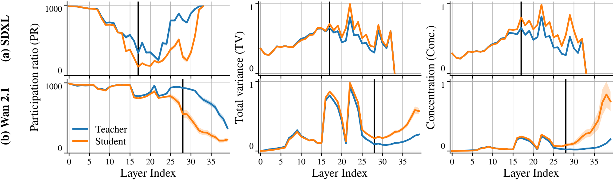

# Reproducing ReDiverse

The full reference for this repository: environments, the commands behind the paper's main comparison, design-choice and ablation tables and probe results, the released weights, activation probing, the repository layout and the licenses. Not included: the baselines (Noise Optimization, DP-DMD, DFD), the user study and the VLM-as-a-judge study, the comparison of two MiniMax-H3 students (Tab. 6, FastVideo and Turbo), the paired comparison with the student (win rates and sign test) and the SAM 3 foreground and background diversity. The [README](../README.md) has the short version.

## Contents

- [Installation](#installation)
- [Quickstart](#quickstart)
- [Released weights](#released-weights)
- [Probing the collapse](#probing-the-collapse)
- [Reproducing the paper](#reproducing-the-paper)
- [Repository structure](#repository-structure)
- [License](#license)

## Installation

```bash
git clone https://github.com/H-furkan/rediverse
cd rediverse
```

The paper's numbers come from six Python environments whose pins are incompatible (for example,
MiniMax-H3 needs diffusers 0.40 / transformers 5.x, while ImageReward needs transformers < 4.57).
[`envs/`](../envs/README.md) pins every package of each one; install them with `--no-deps`:

```bash
python3.12 -m venv venvs/train  && venvs/train/bin/pip  install --no-deps -r envs/requirements-train.txt
python3.12 -m venv venvs/image  && venvs/image/bin/pip  install --no-deps -r envs/requirements-image.txt
python3.12 -m venv venvs/video  && venvs/video/bin/pip  install --no-deps -r envs/requirements-video.txt
python3.12 -m venv venvs/tpips  && venvs/tpips/bin/pip  install --no-deps -r envs/requirements-tpips.txt
python3.10 -m venv venvs/vbench && venvs/vbench/bin/pip install --no-deps -r envs/requirements-vbench.txt
# vipe (camera trajectories only): see envs/vipe.md
```

| Environment | Used for |
|---|---|
| `train` | ReDiverse-FT training (SDXL, SD3, Wan 2.1); the Wan 2.1 target bank; everything for SD3 (caption encoding, noise bank, generation, directions) |
| `image` | SDXL noise bank, generation and directions; image metrics (DINO, Vendi, DreamSim, LPIPS, CLIPScore, HPSv2.1, ImageReward) and tables |
| `video` | Wan 2.1 text contexts, generation and directions; the whole MiniMax-H3 pipeline; activation probing of all four backbones |
| `tpips` | TPIPS (images and video), video DINO and V-JEPA 2 features, video metric aggregation and tables |
| `vbench` | ViCLIP scores, VBench subject / background consistency |
| `vipe` | camera trajectories (ViPE) |

Requirements:

- NVIDIA GPUs with 80 GB of memory were used for every stage (H100); the `train` environment uses
  the CUDA 13.0 build of torch, the others CUDA 12.6.
- `ffmpeg` and `ffprobe` with `libx264` on `PATH`: every video is written through an ffmpeg pipe
  (H.264, CRF 17, yuv420p) and every video metric decodes frames with ffmpeg.
- Models are downloaded from the Hugging Face Hub into `HF_HOME` at pinned revisions on first use
  ([`evaluation/README.md`](../evaluation/README.md) lists the few that the metric packages resolve
  themselves). SD3-Medium is gated: accept its license on the Hub and run `hf auth login` first.
- `REDIVERSE_DATA` (default `./data`) and `REDIVERSE_OUT` (default `./outputs`) relocate data and
  outputs. Run every command from the repository root.
- `REDIVERSE_HF_REPO` (default `ReDiverse/ReDiverse`) sets the Hub repository the released adapters
  are downloaded from, e.g. a fork or mirror with the same layout.

## Quickstart

One prompt per backbone; the command has the same form on every backbone. `--arm` takes `teacher`,
`student`, `rediverse_ft`, `rediverse_tf` or `rediverse`, and `--num-samples` sets the number of
samples. They are written to `<REDIVERSE_OUT>/<backbone>/prompt/<slug>/<arm>/00.png`, `01.png`, ...
(`.mp4` for video), where `<slug>` is the prompt in lowercase with every run of other characters
replaced by `_` and leading/trailing `_` removed; a slug longer than 80 characters is cut to 71
characters and followed by `_` and an 8-character hash of the full prompt.

- On every backbone the FT arms (`rediverse_ft`, `rediverse`) download the released
  ReDiverse-FT adapter from the Hub on first use; `--adapter` points them at a local file or
  directory instead.
- The TF arms (`rediverse_tf`, `rediverse`) first estimate the prompt's teacher directions and save
  them to `<REDIVERSE_OUT>/<backbone>/prompt/<slug>/directions.pt`. Later calls reuse that file only
  when it holds the same prompt (on Wan 2.1 and MiniMax-H3 also the same `--prompt-index`) and
  estimate it again otherwise; `--directions FILE` uses another file as given. The teacher is freed
  before the student is loaded.
- Sample `k` follows the benchmark seed rules of prompt index 0. On Wan 2.1 and MiniMax-H3,
  `--prompt-index i` selects another index, so the text of VBench prompt `i` with `--prompt-index i`
  reproduces that prompt's benchmark clips.

**SDXL** (`image` environment):

```bash
python -m sdxl.generate --arm rediverse --prompt "a photo of a fox in the snow" --num-samples 4 --device cuda:0
# -> outputs/sdxl/prompt/a_photo_of_a_fox_in_the_snow/rediverse/00.png ... 03.png
```

**SD3** (`train` environment):

```bash
python -m sd3.generate --arm rediverse --prompt "a photo of a fox in the snow" --num-samples 4 --device cuda:0
# -> outputs/sd3/prompt/a_photo_of_a_fox_in_the_snow/rediverse/00.png ... 03.png
```

**Wan 2.1** (`video` environment). The first TF call for a prompt spends about 15 min on an H100
estimating its directions (a 2.7 GB file); `--arm rediverse_ft` needs none.

```bash
python -m wan.generate --arm rediverse --prompt "a corgi surfing a wave at sunset" --num-samples 4 --device cuda:0
# -> outputs/wan2.1/prompt/a_corgi_surfing_a_wave_at_sunset/rediverse/00.mp4 ... 03.mp4
```

**MiniMax-H3** (`video` environment), training-free ReDiverse-TF. The directions take about one
GPU-hour and 30 GB of host RAM on the first call for a prompt (a 3.2 GB file). Before downloading or
running MiniMax-H3, check that the territory and terms of the MiniMax H3 Community License allow your use.

```bash
python -m h3.generate --arm rediverse_tf --prompt "a corgi running on the beach at sunset" --num-samples 4 --device cuda:0
# -> outputs/minimax-h3/prompt/a_corgi_running_on_the_beach_at_sunset/rediverse_tf/00.mp4 ... 03.mp4
```

The MiniMax-H3 ReDiverse-FT adapter is on the Hub under `minimax-h3/`, released for research
purposes; its use is governed by the MiniMax H3 Community License, whose Applicable Territory
excludes the EU, the UK, the Republic of Korea and the USA; check that the license allows your use
before downloading or running MiniMax-H3 or the adapter. Each backbone README lists the remaining
options.

## Released weights

The ReDiverse-FT adapters are on the Hugging Face Hub at
[`ReDiverse/ReDiverse`](https://huggingface.co/ReDiverse/ReDiverse):

| Backbone | Student | Teacher | File | Size | License |
|---|---|---|---|---:|---|
| SDXL | [tianweiy/DMD2](https://huggingface.co/tianweiy/DMD2) (4-step UNet) | [stabilityai/stable-diffusion-xl-base-1.0](https://huggingface.co/stabilityai/stable-diffusion-xl-base-1.0) | `sdxl/rediverse_ft.safetensors` | 216 MB | CC BY-NC-SA 4.0 (non-commercial), with the use restrictions of Open RAIL++-M |
| SD3 | [Luo-Yihong/TDM_sd3_lora](https://huggingface.co/Luo-Yihong/TDM_sd3_lora) | [stabilityai/stable-diffusion-3-medium-diffusers](https://huggingface.co/stabilityai/stable-diffusion-3-medium-diffusers) | `sd3/rediverse_ft.safetensors` | 89 MB | Stability AI Community License |
| Wan 2.1 | [lightx2v/Wan2.1-T2V-14B-StepDistill-CfgDistill-Lightx2v](https://huggingface.co/lightx2v/Wan2.1-T2V-14B-StepDistill-CfgDistill-Lightx2v) | [Wan-AI/Wan2.1-T2V-14B-Diffusers](https://huggingface.co/Wan-AI/Wan2.1-T2V-14B-Diffusers) | `wan2.1/rediverse_ft.safetensors` | 445 MB | Apache-2.0 |
| MiniMax-H3 | [lightx2v/Minimax-h3-Turbo](https://huggingface.co/lightx2v/Minimax-h3-Turbo) | [MiniMaxAI/MiniMax-H3](https://huggingface.co/MiniMaxAI/MiniMax-H3) | `minimax-h3/rediverse_ft.safetensors` | 612 MB | MiniMax H3 Community License |

Each file holds the fp32 LoRA tensors (rank 32, alpha 32) of one adapter under
`<module>.lora_A.weight` / `<module>.lora_B.weight`, with module paths inside the student's denoiser,
plus string metadata; the `config.json` beside it lists the adapted modules, the base models with
their pinned revisions and the recipe. Each folder also holds the license texts that apply to it
and a `NOTICE` file crediting its base models (see [License](#license)). ReDiverse-TF needs no
weights: its directions are estimated per prompt by the code. The MiniMax-H3 adapter is
released for research purposes; its use is governed by the MiniMax H3 Community License, whose Applicable
Territory excludes the EU, the UK, the Republic of Korea and the USA; check that the license
allows your use before downloading or running MiniMax-H3 or the adapter.

## Probing the collapse

The collapsed block ℓ comes from probing the activations of the teacher and the student under
identical inputs (paper Sec. 3.1 and App. A). For one prompt, both models get the same N = 1000
noises as the input of their first denoising step (conditional branch, one forward). At every
block the N flattened activations, centred over the noises, give a covariance Σ<sub>b</sub> whose
eigenvalues λ<sub>j</sub> are read off the N x N Gram matrix:

| Quantity | Definition | Meaning |
|---|---|---|
| Total variance | TV = Tr(Σ<sub>b</sub>) = Σ<sub>j</sub> λ<sub>j</sub> | how far the activations move when the noise changes |
| Participation ratio | PR = (Σ<sub>j</sub> λ<sub>j</sub>)<sup>2</sup> / Σ<sub>j</sub> λ<sub>j</sub><sup>2</sup> | how many directions that variance effectively spans |
| Concentration | Conc = TV / PR | variance carried per effective direction |

<p align="center">
  
</p>
<p align="center"><sub>Participation ratio, total variance and concentration at every block of the first denoising
step (paper Fig. 2; TV and Conc min-max normalised over teacher and student). The vertical line marks the
collapsed block.</sub></p>

Early blocks of the students track their teachers; from the collapsed block on, the student keeps
(or amplifies) the total variance but spans far fewer directions. Student/teacher ratios at ℓ
(paper Tab. 1, means over prompts):

| Student | PR | TV | Conc |
|---|---:|---:|---:|
| DMD2 (SDXL) | 0.40 | 1.63 | 4.76 |
| TDM (SD3) | 0.49 | 1.03 | 2.68 |
| lightx2v (Wan 2.1) | 0.60 | 1.41 | 2.54 |
| Turbo (MiniMax-H3) | 0.37 | 2.92 | 8.08 |

Every backbone has a probe with the same interface; `rediverse.probe_report` turns the per-prompt
records into the per-block table and these ratios:

```bash
python -m sdxl.probe --arm teacher --prompt-ids 27 --device cuda:0   # video env, about 4 min per arm
python -m sdxl.probe --arm student --prompt-ids 27 --device cuda:0
python -m rediverse.probe_report --backbone sdxl --tsv sdxl_probe.tsv --plot sdxl_probe.png
```

`sd3.probe`, `wan.probe` and `h3.probe` take the same arguments
(`rediverse.probe_report --backbone sd3 | wan2.1 | minimax-h3`). All probes run in the `video`
environment, where they reproduce the paper's per-prompt records (SD3 exactly, SDXL to 1e-6
relative); other diffusers versions move the values by up to about 1e-3. Without `--prompt-ids` they probe
the paper's prompt sets: the 100 GenEval prompts of `prompts/geneval_subset100.txt` for the image
backbones and the 20 of `prompts/probe_video20.txt` for the video backbones (Wan 2.1 at 17 frames,
as in the paper; MiniMax-H3 at the release's 124 frames, the setting of its Tab. 1 row). Noise `i`
of prompt `p` is seeded `1_000_000 + p * 100003 + i` in both arms. Activations are staged on the
host in the model's dtype and the Gram is accumulated in float64 on the GPU; `--ram-gb` (default
256) caps the staging memory, and blocks that do not fit are probed in further passes over the same
noises, which leaves the results unchanged. The video backbones stage 40-200 M values per block and
noise, so they need a large host or a smaller `--n`. A block larger than `--ram-gb` is staged on its own
whatever the budget: one MiniMax-H3 block at the default N = 1000 is 1000 x 37,296 x 5376 bf16 values,
about 400 GB, so each `h3.probe` worker needs at least that much free host RAM. `scripts/h3.sh probe`
starts one worker per GPU; on a smaller host give it fewer `GPUS` (one worker at a time) or lower `--n`.

## Reproducing the paper

Per backbone: data preparation, ReDiverse-FT training, ReDiverse-TF directions, generation of the
five arms (`teacher`, `student`, `rediverse_ft`, `rediverse_tf`, `rediverse`), evaluation, table.
Every default reproduces the released artifacts; the backbone READMEs give the exact recipes, seed
rules and file layouts. GPU times are for 80 GB H100s. Each backbone also has an end-to-end driver,
`bash scripts/<backbone>.sh <stage> ...` (see [`scripts/`](../scripts/README.md)).

### SDXL

[`sdxl/README.md`](../sdxl/README.md). ReDiverse-FT trains on [NVIDIA FastGen](https://github.com/NVlabs/FastGen)
(cloned at a pinned commit by `sdxl/setup_fastgen.sh`) on 100 DiffusionDB captions x 16 noises,
4 captions x 8 noises per step, 200 steps.

```bash
# data (image env): frozen evaluation noise, GenEval-553 x 100, 7.25 GB
python -m sdxl.make_noise_bank --device cuda:0
# ReDiverse-FT (train env): about 95 min on one GPU
bash sdxl/setup_fastgen.sh
python prompts/download_train_captions.py
python -m sdxl.encode_captions --device cuda:0
python -m sdxl.build_init_ckpt
export HF_HOME=${HF_HOME:-$HOME/.cache/huggingface}
CUDA_VISIBLE_DEVICES=0 python -m sdxl.train
python -m sdxl.convert_weights --src outputs/sdxl/train/adapters/rediverse_ft_0000200.pth --out-dir outputs/sdxl/release
# ReDiverse-TF directions (image env): about 14 s per prompt, 11.6 GB for all 553
python -m sdxl.estimate_directions --device cuda:0
# five arms (image env): about 9 GPU-hours per 4-step arm, 37 for the teacher
for arm in teacher student rediverse_ft rediverse_tf rediverse; do
  python -m sdxl.generate --arm $arm --device cuda:0
done
```

`sdxl.generate` uses the released adapter; `--adapter outputs/sdxl/release` uses yours.

### SD3

[`sd3/README.md`](../sd3/README.md). 100 DiffusionDB captions x 16 noises, 4 captions x 8 noises per
step, 200 steps. All stages run in the `train` environment.

```bash
python prompts/download_train_captions.py
python -m sd3.encode_prompts --device cuda:0
python -m sd3.make_noise_bank --device cuda:0           # GenEval-553 x 100, about 29 GB
python -m sd3.train --device cuda:0                     # about 61 min on one GPU
python -m sd3.convert_weights --src outputs/sd3/train/adapters/rediverse_ft_0000200.pth --out-dir outputs/sd3/release
python -m sd3.estimate_directions --device cuda:0       # about 10 s per prompt, about 56 GB for all 553
for arm in teacher student rediverse_ft rediverse_tf rediverse; do
  python -m sd3.generate --arm $arm --device cuda:0     # teacher about 31 GPU-hours, 4-step arms 1.7-3.4 img/s
done
```

`--adapter outputs/sd3/release` generates with your adapter.

### Wan 2.1

[`wan/README.md`](../wan/README.md). 100 DiffusionDB captions x 16 latents, 4 captions x 8 latents per
step, 200 steps, against a precomputed bank of teacher targets.

```bash
python prompts/download_train_captions.py
python -m wan.encode_prompts --set train,vbench,neg --device cuda:0          # video env
for g in 0 1 2 3 4 5 6 7; do                                                 # train env: 1,600 targets,
  CUDA_VISIBLE_DEVICES=$g python -m wan.build_targets --device cuda:0 --shard $g --num-shards 8 &
done; wait                                                                   # about 23 GPU-hours, 512 GiB
CUDA_VISIBLE_DEVICES=0,1,2,3,4,5,6,7 PYTORCH_CUDA_ALLOC_CONF=expandable_segments:True \
  torchrun --standalone --nproc_per_node 8 -m wan.train                      # train env: about 3 h on 8 GPUs
python -m wan.convert_weights --src outputs/wan2.1/train/adapters/rediverse_ft_0000200.pth --out-dir outputs/wan2.1/release
for g in 0 1 2 3 4 5 6 7; do                                                 # video env: about 77 GPU-hours,
  CUDA_VISIBLE_DEVICES=$g python -m wan.estimate_directions --device cuda:0 --shard $g --num-shards 8 &
done; wait                                                                   # 805 GB for VBench-300
for arm in teacher student rediverse_ft rediverse_tf rediverse; do           # video env: teacher about 440 s,
  for g in 0 1 2 3 4 5 6 7; do                                               # 4-step arms about 21 s per clip
    CUDA_VISIBLE_DEVICES=$g python -m wan.generate --arm $arm --device cuda:0 --shard $g --num-shards 8 &
  done; wait
done
```

`--adapter outputs/wan2.1/release` generates with your adapter.

### MiniMax-H3

[`h3/README.md`](../h3/README.md). ReDiverse-FT trains on 20 GenEval prompts
(`prompts/h3_train_geneval_ids.txt`) x 20 latents against a precomputed bank of teacher targets,
4 micro-batches of 2 latents per step, 200 steps, with the MSE normalised by the target variance.
This recipe differs from the shared recipe of the other three pairs (100 DiffusionDB captions x 16 noises, batch 32,
plain MSE) that the paper describes for all four pairs; the paper's MiniMax-H3 ReDiverse-FT rows come from this one.
All stages run in the `video` environment.

```bash
export PYTORCH_CUDA_ALLOC_CONF=expandable_segments:True
python -m h3.encode_prompts --set train --device cuda:0   # text contexts of the 20 training prompts
python -m h3.generate --encode --device cuda:0             # text contexts of VBench-300
python -m h3.build_targets --device cuda:0          # one worker per GPU: 400 targets, about 17 GPU-hours, 166 GB
python -m h3.train --device cuda:0 --dev1 cuda:1    # two 80 GB GPUs, about 22 h
python -m h3.convert_weights --src outputs/minimax-h3/train/adapters/rediverse_ft_0000200.pth \
    --out-dir outputs/minimax-h3/train/rediverse_ft
python -m h3.estimate_directions --device cuda:0    # one worker per GPU: about 1 GPU-hour and 30 GB host RAM per prompt
for arm in teacher student rediverse_tf; do         # latents: teacher about 440 s, 4-step arms about 30 s per clip
  python -m h3.generate --arm $arm --device cuda:0
done
for arm in rediverse_ft rediverse; do
  python -m h3.generate --arm $arm --adapter outputs/minimax-h3/train/rediverse_ft --device cuda:0
done
for arm in teacher student rediverse_ft rediverse_tf rediverse; do
  python -m h3.generate --arm $arm --decode --device cuda:0
done
```

### Evaluation and tables

[`evaluation/README.md`](../evaluation/README.md) defines every metric and lists the per-stage commands.
Each generated arm is one set; every set is scored, then the table scripts print the paper's rows.

```bash
# images (image + tpips envs): several GPU-hours per 55,300-image set
export PY_IMAGE=venvs/image/bin/python PY_TPIPS=venvs/tpips/bin/python
for b in sdxl sd3; do
  for arm in teacher student rediverse_tf rediverse_ft rediverse; do
    bash evaluation/image/evaluate_set.sh outputs/$b/$arm/images outputs/$b/$arm --gpu 0
  done
done
python -m evaluation.tables.image_table \
    --block SDXL teacher=outputs/sdxl/teacher student=outputs/sdxl/student rediverse_tf=outputs/sdxl/rediverse_tf \
                 rediverse_ft=outputs/sdxl/rediverse_ft rediverse=outputs/sdxl/rediverse \
    --block SD3  teacher=outputs/sd3/teacher student=outputs/sd3/student rediverse_tf=outputs/sd3/rediverse_tf \
                 rediverse_ft=outputs/sd3/rediverse_ft rediverse=outputs/sd3/rediverse

# videos (tpips + vbench + vipe envs): ViPE alone takes 8-11 GPU-hours per set
for b in wan2.1 minimax-h3; do
  for arm in teacher student rediverse_tf rediverse_ft rediverse; do
    CUDA_VISIBLE_DEVICES=0 evaluation/video/evaluate_set.sh outputs/$b/$arm
  done
done
python -m evaluation.tables.video_table --backbone wan
python -m evaluation.tables.video_table --backbone h3
```

## Repository structure

```
rediverse/
├── README.md
├── LICENSE                      Apache-2.0
├── assets/                      figures and animations of this README
├── envs/                        pinned requirements of the six environments + README, vipe.md
├── prompts/                     GenEval-553, VBench-300 and their subsets, H3 training prompt ids, probe prompt ids,
│                                download_train_captions.py (the 100 DiffusionDB training captions),
│                                README.md (sources, indexing and licenses)
├── rediverse/                   backbone-agnostic helpers
│   ├── seeds.py                 every seed rule (training noise, evaluation noise, direction latents, TF coefficients)
│   ├── directions.py            ReDiverse-TF: principal directions from teacher samples, offsets, direction files
│   ├── probe.py                 activation probing: per-block TV / PR / concentration from the noise Gram
│   ├── probe_report.py          probe records -> per-block table, student/teacher ratios (Tab. 1), plot
│   ├── data.py                  training captions, step sampler, run metadata
│   ├── hub.py                   released adapter download and loading
│   ├── claims.py                per-item locks for multi-worker runs
│   └── video_io.py              ffmpeg video writer and reader
├── sdxl/                        SDXL + DMD2
│   ├── config.py                model ids, pinned revisions, recipe constants
│   ├── make_noise_bank.py       frozen evaluation noise
│   ├── encode_captions.py       training-caption embeddings
│   ├── build_init_ckpt.py       FastGen initialisation checkpoint
│   ├── setup_fastgen.sh         clones FastGen at a pinned commit and adds fastgen_overlay/
│   ├── fastgen_overlay/         the ReDiverse-FT method, data loader and config added to FastGen
│   ├── teacher_rollout.py       teacher Euler rollout hooked at block ℓ (FT targets, TF directions)
│   ├── train.py                 ReDiverse-FT training
│   ├── extract_adapter.py       FastGen checkpoint -> adapter (.pth)
│   ├── convert_weights.py       extracted adapter (.pth) -> released safetensors
│   ├── estimate_directions.py   ReDiverse-TF directions
│   ├── generate.py              the five arms, benchmark and --prompt mode
│   └── probe.py                 per-block variance characteristic (teacher or student)
├── sd3/                         SD3-Medium + TDM (config, encode_prompts, make_noise_bank, model, train,
│                                convert_weights, estimate_directions, generate, probe)
├── wan/                         Wan 2.1 + lightx2v (config, encode_prompts, cfgd_teacher, target_bank,
│                                build_targets, model, train, convert_weights, estimate_directions, generate,
│                                probe)
├── h3/                          MiniMax-H3 + Turbo (config, encode_prompts, build_targets, model, split2,
│                                train, convert_weights, estimate_directions, generate, probe)
├── evaluation/
│   ├── common/                  prompt-grid checks, pairwise diversity, TPIPS factors and the pinned
│   │                            TPIPS-Embed checkpoint, atomic writes
│   ├── image/                   image metrics and the per-set driver evaluate_set.sh
│   ├── video/                   video metrics and the per-set driver evaluate_set.sh
│   └── tables/                  image_table.py, video_table.py: per-set metrics -> paper rows
└── scripts/                     end-to-end drivers: sdxl.sh, sd3.sh, wan.sh, h3.sh
```

## License

The code in this repository is released under the [Apache License 2.0](../LICENSE).

SDXL training runs on [NVIDIA FastGen](https://github.com/NVlabs/FastGen) (Apache-2.0), which
`sdxl/setup_fastgen.sh` clones at a pinned commit into `third_party/FastGen`. The files in
`sdxl/fastgen_overlay/` are ReDiverse additions (Apache-2.0) copied into that checkout; no FastGen
file is modified, FastGen's `LICENSE` and `licenses/` stay in place, and the added files are listed
in `REDIVERSE_OVERLAY.md` inside the checkout.

The released adapters (in the Hub repository [`ReDiverse/ReDiverse`](https://huggingface.co/ReDiverse/ReDiverse),
whose folders hold the license and NOTICE files named below) follow the licenses of their base
models. The SDXL adapter is trained on DMD2,
which is released under CC BY-NC-SA 4.0, so the adapter is released for non-commercial use under
CC BY-NC-SA 4.0 (`sdxl/LICENSE-CC-BY-NC-SA-4.0.md`); the SDXL base weights it runs with remain subject
to the use-based restrictions of Attachment A of the CreativeML Open RAIL++-M License, whose text
ships next to it as `sdxl/LICENSE-OpenRAIL++-M.md`. The SD3 adapter is a Derivative Work of Stable
Diffusion 3 Medium under the Stability AI Community License, the license of
`stabilityai/stable-diffusion-3-medium` since July 5, 2024; it ships with that license as
`sd3/LICENSE.md` and with a `sd3/NOTICE` file. Powered by Stability AI.
The Wan 2.1 adapter is Apache-2.0 (`wan2.1/LICENSE.txt`), like Wan 2.1, lightx2v and the Perflow LoRA.
MiniMax-H3 is distributed under the MiniMax H3 Community License, which limits use and distribution
to its Applicable Territory (the EU, the UK, the Republic of Korea and the USA are excluded) and also
covers adapters trained on MiniMax-H3, as works based on it. The MiniMax-H3 adapter
(`minimax-h3/`, with `minimax-h3/LICENSE` and `minimax-h3/NOTICE`) is released for research
purposes; its use is governed by that license; check that it allows your use before downloading or running
MiniMax-H3 or the adapter.

The evaluation prompts come from GenEval (MIT) and VBench (Apache-2.0);
[`prompts/README.md`](../prompts/README.md) gives their sources and license notices. The `tpips`
package used for TPIPS is installed from PyPI (`tpips==0.1.2`); its package metadata declares the
Adobe Research License (`LicenseRef-Adobe-Research-License`), which permits noncommercial research
use only.
